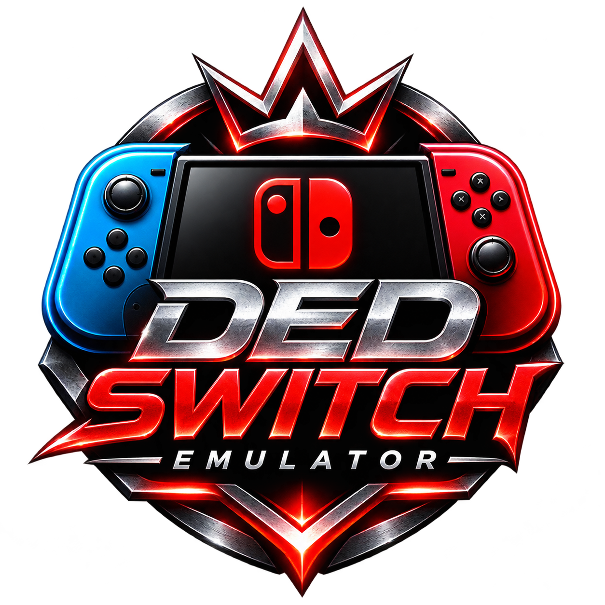

# DED SWITCH

### PROJECT ADRENO BEAST

**A community-driven Nintendo Switch emulation project.**

Built with performance, compatibility and Android development in mind.

[Architecture](#architecture) · [Roadmap](#roadmap) · [Building](#building) · [License](#license)

---

## About DED SWITCH

DED SWITCH is an experimental emulator project based on the existing open-source emulator codebase.

Our goal is to develop a distinct emulator experience with a redesigned identity, improved Android integration, performance-focused development and a modular architecture.

Our first hardware development target is:

| Component | Target |
|---|---|
| Device | Samsung Galaxy S25 Ultra |
| Processor | Snapdragon 8 Elite |
| GPU | Adreno 830 |
| Architecture | ARM64 |
| Graphics API | Vulkan |

These are development targets, not a guarantee of game compatibility or performance.

## Project Vision

DED SWITCH aims to develop:

- A redesigned gaming interface.
- Per-game configuration and profiles.
- Vulkan graphics and driver management.
- Adaptive performance management.
- Controller configuration and calibration.
- Touchscreen control customization.
- Save Vault and backup protection.
- Diagnostic and recovery tools.
- Secure updates and release verification.

## Architecture

The project is intended to use a modular architecture:

| Module | Purpose |
|---|---|
| Graphics Engine | Vulkan rendering and GPU integration |
| Performance Engine | Frame pacing and performance management |
| Driver Manager | Compatible user-space driver management |
| Controller Engine | Controller input and mapping |
| Save Vault | Game save protection and backup |
| Recovery Engine | Diagnostics and safe recovery |
| Release System | Build verification and update management |

Modules will be integrated incrementally and validated against the existing emulator backend.

## Roadmap

### Phase 1 — Foundation
- [x] Import upstream source code.
- [x] Establish the DED SWITCH repository.
- [x] Initial branding and README rework.
- [ ] Complete source audit.
- [ ] Verify Android build environment.

### Phase 2 — Android and Graphics
- [ ] Android integration improvements.
- [ ] Vulkan compatibility testing.
- [ ] Adreno driver compatibility evaluation.
- [ ] Graphics diagnostics.

### Phase 3 — Performance
- [ ] Frame pacing improvements.
- [ ] Adaptive resolution research.
- [ ] Thermal-aware performance profiles.
- [ ] Performance monitoring.

### Phase 4 — Controller System
- [ ] Unified controller architecture.
- [ ] Bluetooth and USB input integration.
- [ ] Custom touchscreen layouts.
- [ ] Calibration and diagnostics.

### Phase 5 — Save Vault
- [ ] Save protection architecture.
- [ ] Automated backup.
- [ ] Recovery and restore validation.
- [ ] Storage management.

### Phase 6 — Release Engineering
- [ ] Reproducible build pipeline.
- [ ] Signed release verification.
- [ ] Crash diagnostics.
- [ ] Stable and experimental channels.

> Roadmap items are development goals. They are not claims of completed functionality.

## Building

DED SWITCH requires a compatible development environment and the appropriate Android SDK, NDK, CMake and Java toolchain.

Build instructions will be documented after the Android build configuration has been audited and verified.

## Development Status

DED SWITCH is under active development.

Compatibility, stability, performance and supported devices will be documented only after testing.

No official stable release is currently announced.

## Credits and Upstream Acknowledgements

DED SWITCH builds upon the work of the upstream open-source emulator project and its contributors.

We acknowledge the contributions of the upstream projects and developers whose work makes continued development possible.

Original copyright notices, attribution and applicable license requirements are retained.

## License

This project is distributed under the GNU General Public License v3.0 or later, subject to the applicable upstream licensing terms.

See [LICENSE](./LICENSE) for details.

---

**DED SWITCH — PROJECT ADRENO BEAST**

*Built for the next level of emulation.*

